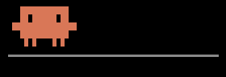
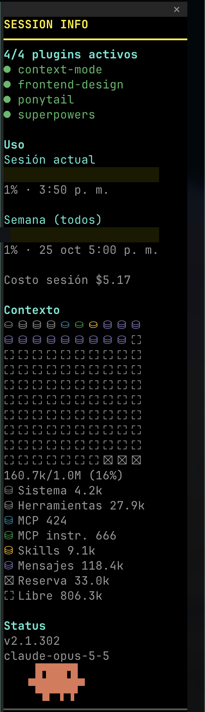
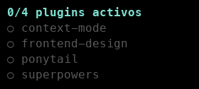
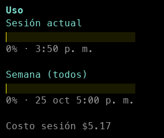
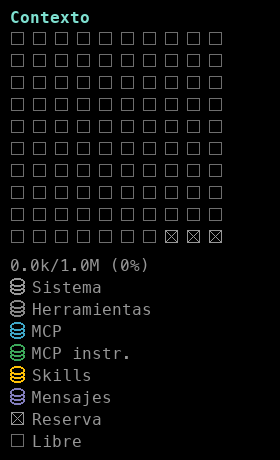
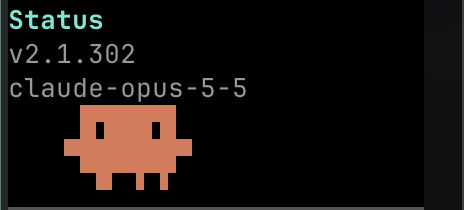

<div align="center">

# ⚡ Session Info

**A Claude Code sidebar that shows, live, everything going on in your session.**

Plugins · Usage · Cost · Context · Version · Model · and a walking Clawd

**English** · [Español](README.es.md)



</div>

---

<table>
<tr>
<td width="300" valign="top"></td>
<td valign="top">

### What is it?

Session Info is a Claude Code mod that opens a pane beside your terminal. While you work, it updates itself and shows you at a glance:

- 🧩 **Plugins**: which ones are enabled
- 📊 **Usage**: your session and weekly consumption, and the cost
- 🧠 **Context**: how much of the context window you've used and what's using it
- 🏷️ **Status**: Claude Code version and model
- 🦀 **Clawd**: the Claude mascot, to liven up your workspace

It opens by itself on wide terminals; otherwise run `/session-info`.

</td>
</tr>
</table>

---

## 🧩 Enabled plugins

<table>
<tr>
<td width="300" valign="top"></td>
<td valign="top">

Shows **which plugins you've chosen to have enabled**.

- <code>●</code> green: the plugin is enabled
- <code>○</code> gray: installed but turned off

The total sits on top (for example `4/4 plugins activos`). Enable or disable a plugin with `/plugin` and the pane follows within a couple of seconds.

</td>
</tr>
</table>

## 📊 Token usage

<table>
<tr>
<td width="300" valign="top"></td>
<td valign="top">

The yellow bars show your **current session** and **weekly** usage, with the percentage used and when each one resets.

So you **keep an eye on your consumption while you work**, without leaving to check `/usage`.

Below them is the **session cost**, to help you **keep your budget under control**.

> The bars show on subscription plans, after Claude's first reply in the session. The cost is the API-equivalent figure `/cost` reports.

</td>
</tr>
</table>

## 🧠 Context

<table>
<tr>
<td width="300" valign="top"></td>
<td valign="top">

The same grid as `/context`, always in view. **Each cell is 1% of your context window**, and each color is a category.

Useful for **optimizing how you manage context**: as you add plugins, MCPs or skills, you'll see whether they **help or eat into it**. Icons make it far more intuitive than reading numbers.

| Icon | Category | What it is |
|:--:|---|---|
| ⛁ | **Sistema** | Claude Code's base instructions |
| ⛁ | **Herramientas** | Built-in tools (Bash, Read, Edit…) |
| ⛁ | **MCP** | Tools from your MCP servers |
| ⛁ | **MCP instr.** | Instructions your MCP servers add |
| ⛁ | **Skills** | Available skills; every plugin with skills adds here |
| ⛁ | **Mensajes** | Your conversation: messages, replies and tool results. The one that grows most |
| ⛝ | **Reserva** | Space kept for auto-compaction; when the discs reach it, Claude compacts the conversation |
| ⛶ | **Libre** | What's left |

</td>
</tr>
</table>

## 🏷️ Status

<table>
<tr>
<td width="300" valign="top"></td>
<td valign="top">

Shows **at a glance which version you're on and which model you're using**.

Invaluable for knowing you're **up to date** and on **the right model for your tasks**.

</td>
</tr>
</table>

## 🦀 Clawd

<table>
<tr>
<td width="300" valign="top"></td>
<td valign="top">

Clawd, the Claude Code mascot, walks back and forth along the bottom of the pane in Claude orange.

It measures nothing: it's there **just to bring some life to your workspace**.

</td>
</tr>
</table>

---

## 📦 Install

At the prompt of a Claude Code terminal session:

```
/plugin install session-info --marketplace RedfoxGT/session-info
```

Answer `y` to add the marketplace, then pick a scope.

From a shell:

```
claude plugin install session-info --marketplace RedfoxGT/session-info
```

In the desktop app: click **+** next to the prompt box, then **Plugins**, **Add marketplace** with `RedfoxGT/session-info`, then **Add plugin**.

---

<div align="center">

Made by **Byron Juarez** · <a href="mailto:byron@nexxus.dev">byron@nexxus.dev</a>

</div>
